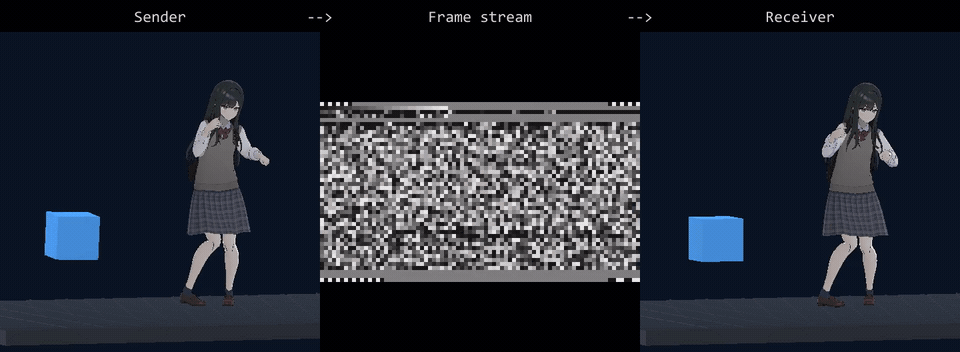

<p align="center">
  
</p>

<p align="center"><strong>Send VRChat state and motion through texture streams.</strong></p>

<p align="center">
  <a href=".github/assets/tsmp-showcase.mp4"></a>
</p>
<p align="center">
  <a href=".github/assets/tsmp-showcase.mp4"><strong>▶ Watch the 16-second demo</strong></a><br>
  <sub>Left to right: sender · frame stream · receiver — local Native Unity demo with falling cubes and skirt PhysBones</sub><br>
  <sub>The PAUSED interval at about 4–6.5 seconds demonstrates interrupted reception and recovery. The sender keeps running.</sub><br>
  <sub>Avatar: <a href="https://booth.pm/ja/items/5405703">Hayakawa Aoi © 2024 WARPSTORE</a> · Motion: <a href="https://kevdev.itch.io/human-dance-animations-free">Kevin Iglesias</a></sub>
</p>

<p align="center">
  <a href="https://github.com/kibalab/TSMP-Core/blob/main/LICENSE.md"></a>
  <a href="https://github.com/kibalab/TSMP-Core/actions/workflows/release.yml"></a>
  <a href="https://github.com/kibalab/TSMP-Core/releases/latest"></a>
  <a href="https://github.com/kibalab/TSMP-Core/releases"></a>
</p>

<p align="center">
  <a href="https://github.com/kibalab/TSMP-Core/blob/main/Packages/com.kibalab.tsmp.core/package.json"></a>
  <a href="https://github.com/kibalab/TSMP-Core/blob/main/Packages/com.kibalab.tsmp.core/package.json"></a>
  <a href="https://vpm.kiba.red/"></a>
  <a href="https://kibalab.github.io/TSMP-Core/"></a>
</p>

<p align="center">
  <a href="#installation">Get started</a> &nbsp;·&nbsp;
  <a href="https://kibalab.github.io/TSMP-Core/">Documentation</a> &nbsp;·&nbsp;
  <a href="https://github.com/kibalab/TSMP-Core/releases">Releases</a> &nbsp;·&nbsp;
  <a href="https://github.com/kibalab/TSMP-Core/issues">Report an issue</a>
</p>

<p align="center">
  <a href="README.ko.md">한국어</a> &nbsp;·&nbsp; <strong>English</strong> &nbsp;·&nbsp; <a href="README.md">日本語</a>
</p>

---

## What is TSMP?

TSMP, the Trans Sync Media Protocol, is a communication protocol for sending runtime data through texture streams. TSMP Core is an open-source network framework that provides the runtime, synchronization components, and setup tools for using this protocol in VRChat worlds.

The Encoder turns scene data into pixels; a capture or streaming path carries the image, and the Decoder applies the received data to matching objects.

| Feature | What it provides |
| --- | --- |
| **Texture transport** | TSMP Encoder / Decoder for encoding and decoding runtime data |
| **Multi-instance communication** | Build a synchronization solution across separate VRChat instances using an external capture or streaming path |
| **State and events** | `[TransSync]` field synchronization and `SendTransRPC(methodName, target)` RPC |
| **Motion and playback** | Transform, Rigidbody, Humanoid and VRChat Avatar Pose, BlendShape, Animator, Timeline |
| **Scene setup** | Automatic `TSMPSetup` configuration, codec discovery and selection, component and binding updates |
| **Codec extensions** | Shared runtime APIs, shader includes, and catalog assets for custom codecs |

## Installation

**For VRChat:** Unity 2022.3 LTS · VRChat Worlds SDK 3.9.0 or newer

1. Add this VPM repository in VRChat Creator Companion.

   ```text
   https://vpm.kiba.red/
   ```

2. Install **TSMP Core** and **TSMP Codec Luma4** together, then wait for package import to finish.

Core provides the scene runtime and setup workflow. Separate codec packages provide pixel encoding.

<details>
<summary><strong>Using ordinary Unity without VRCSDK</strong></summary>

- Use Core and Luma4 revisions that include standalone Unity support.
- In Unity Package Manager, choose **Add package from disk** and select each package's `package.json`.
- Use the same Controller prefab below. Components and bindings are prepared automatically.
- The validated configuration is Windows x64 with Mono and managed stripping disabled. See the [installation guide](https://kibalab.github.io/TSMP-Core/docs/getting-started/installation) for reflection, stripping, and IL2CPP validation limits.

</details>

## Quick start

1. Add [`TSMPController.prefab`](Packages/com.kibalab.tsmp.core/Samples/TSMPController.prefab) to your scene.
2. Add the `TSMPNetwork*` components you need to the objects you want to synchronize.
3. In `TSMPSetup`, click `Refresh Codecs` and check the codec and input/output settings. Components and bindings update automatically.
4. Enter Play Mode or test in VRChat, then verify encoding and decoding with the shared Controller's default local loopback.
5. For external transport, broadcast the Encoder output RenderTexture and connect the received TSMP image to the Decoder input texture.

**Generated resources:** Keep `Assets/TSMPGenerated` with your scene in version control.

[Full quickstart guide](https://kibalab.github.io/TSMP-Core/docs/getting-started/quickstart) · [Texture transport setup](https://kibalab.github.io/TSMP-Core/docs/guides/texture-transport)

## Guides

| What you want to do | Documentation |
| --- | --- |
| Install and configure your first scene | [Installation](https://kibalab.github.io/TSMP-Core/docs/getting-started/installation) · [Quickstart](https://kibalab.github.io/TSMP-Core/docs/getting-started/quickstart) |
| Use synchronization components | [Network components](https://kibalab.github.io/TSMP-Core/docs/scripting-api/network-components) |
| Build a custom codec | [Custom codec](https://kibalab.github.io/TSMP-Core/docs/developer/custom-codec) |
| Diagnose reception and decoding | [Troubleshooting](https://kibalab.github.io/TSMP-Core/docs/troubleshooting) |

## Releases and contributions

[Latest stable release](https://github.com/kibalab/TSMP-Core/releases/latest) · [All releases](https://github.com/kibalab/TSMP-Core/releases)

TSMP Core 1.0.0 is a stable release incorporating the features, fixes and optimizations from the betas since 0.2.0. Use it with Luma4 1.0.0.

Report bugs and suggest improvements in [Issues](https://github.com/kibalab/TSMP-Core/issues). For code and documentation contributions, see the [contributing guide](CONTRIBUTING.md).

---

[MIT License](LICENSE.md) · Copyright (c) 2026 KIBA_Labs.
