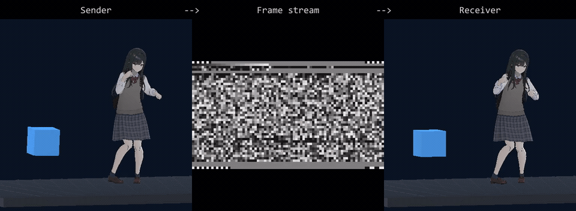

<p align="center">
  
</p>

<p align="center"><strong>VRChat의 상태와 움직임을 텍스처 스트림으로 전송합니다.</strong></p>

<p align="center">
  <a href=".github/assets/tsmp-showcase.mp4"></a>
</p>
<p align="center">
  <a href=".github/assets/tsmp-showcase.mp4"><strong>▶ 16초 데모 영상 보기</strong></a><br>
  <sub>독립된 Native Unity 클라이언트 2개 · 로컬 무압축 프레임 연결 · 일시 정지와 복구</sub>
</p>

<p align="center">
  <a href="https://github.com/kibalab/TSMP-Core/blob/main/LICENSE.md"></a>
  <a href="https://github.com/kibalab/TSMP-Core/actions/workflows/release.yml"></a>
  <a href="https://github.com/kibalab/TSMP-Core/releases/latest"></a>
  <a href="https://github.com/kibalab/TSMP-Core/releases"></a>
</p>

<p align="center">
  <a href="https://github.com/kibalab/TSMP-Core/blob/main/Packages/com.kibalab.tsmp.core/package.json"></a>
  <a href="https://github.com/kibalab/TSMP-Core/blob/main/Packages/com.kibalab.tsmp.core/package.json"></a>
  <a href="https://vpm.kiba.red/"></a>
  <a href="https://kibalab.github.io/TSMP-Core/"></a>
</p>

<p align="center">
  <a href="#설치">설치</a> &nbsp;·&nbsp;
  <a href="https://kibalab.github.io/TSMP-Core/ko/">문서</a> &nbsp;·&nbsp;
  <a href="https://github.com/kibalab/TSMP-Core/releases">릴리즈</a> &nbsp;·&nbsp;
  <a href="https://github.com/kibalab/TSMP-Core/issues">문제 제보</a>
</p>

<p align="center">
  <strong>한국어</strong> &nbsp;·&nbsp; <a href="README.en.md">English</a> &nbsp;·&nbsp; <a href="README.md">日本語</a>
</p>

---

## TSMP는 무엇인가요?

TSMP(Trans Sync Media Protocol)는 런타임 데이터를 텍스처 스트림으로 전달하는 통신 프로토콜입니다. TSMP Core는 이 프로토콜을 VRChat 월드에서 활용할 수 있도록 런타임·동기화 컴포넌트·설정 도구를 제공하는 오픈소스 네트워크 프레임워크입니다.

Encoder가 씬의 데이터를 픽셀로 인코딩하고, 캡처·스트리밍 경로를 거친 영상을 Decoder가 읽어 수신 오브젝트에 적용합니다.

| 기능 | 지원 내용 |
| --- | --- |
| **텍스처 전송** | TSMP Encoder / Decoder로 런타임 데이터를 인코딩·디코딩 |
| **멀티 인스턴스 통신** | 외부 캡처·스트리밍 경로와 결합해 서로 다른 VRChat 인스턴스 간 동기화 솔루션 구성 |
| **상태와 이벤트** | `[TransSync]` 필드 동기화, `SendTransRPC(methodName, target)` RPC |
| **움직임과 재생** | Transform, Rigidbody, Humanoid·VRChat Avatar Pose, BlendShape, Animator, Timeline |
| **씬 구성** | `TSMPSetup` 자동 설정, 코덱 검색·선택, 컴포넌트와 바인딩 자동 갱신 |
| **코덱 확장** | 커스텀 코덱용 공통 런타임, shader include, catalog asset |

## 설치

**VRChat 환경:** Unity 2022.3 LTS · VRChat Worlds SDK 3.9.0 이상

1. VRChat Creator Companion에 아래 VPM 저장소를 추가합니다.

   ```text
   https://vpm.kiba.red/
   ```

2. **TSMP Core**와 **TSMP Codec Luma4**를 함께 설치하고 임포트가 끝날 때까지 기다립니다.

Core는 씬 런타임과 설정을, 별도 코덱 패키지는 픽셀 인코딩을 담당합니다.

<details>
<summary><strong>VRCSDK 없는 일반 Unity에서 사용하기</strong></summary>

- 일반 Unity 지원이 포함된 Core와 Luma4 리비전을 사용합니다.
- Unity Package Manager의 **Add package from disk**에서 각 패키지의 `package.json`을 선택합니다.
- 아래와 동일한 Controller 프리팹을 사용합니다. 컴포넌트와 바인딩은 자동 준비됩니다.
- 검증된 구성은 Windows x64 · Mono · managed stripping 비활성화입니다. 리플렉션·stripping 제약과 IL2CPP 검증 범위는 [설치 가이드](https://kibalab.github.io/TSMP-Core/ko/docs/getting-started/installation)를 참고하세요.

</details>

## 빠른 시작

1. [`TSMPController.prefab`](Packages/com.kibalab.tsmp.core/Samples/TSMPController.prefab)을 씬에 배치합니다.
2. 동기화할 오브젝트에 필요한 `TSMPNetwork*` 컴포넌트를 추가합니다.
3. `TSMPSetup`에서 `Refresh Codecs`를 누르고 코덱·입출력 설정을 확인합니다. 컴포넌트와 바인딩은 자동 갱신됩니다.
4. Play Mode에 진입하거나 VRChat에서 테스트하여, 공유 Controller의 기본 로컬 루프백으로 인코딩·디코딩을 확인합니다.
5. 외부 전송 시 Encoder의 출력 RenderTexture를 송출하고, 수신한 TSMP 영상을 Decoder의 입력 텍스처에 연결합니다.

**생성 리소스:** `Assets/TSMPGenerated`를 씬과 함께 버전 관리하세요.

[전체 빠른 시작 가이드](https://kibalab.github.io/TSMP-Core/ko/docs/getting-started/quickstart) · [텍스처 전송 설정](https://kibalab.github.io/TSMP-Core/ko/docs/guides/texture-transport)

## 가이드

| 필요한 작업 | 문서 |
| --- | --- |
| 첫 씬 설치·구성 | [설치](https://kibalab.github.io/TSMP-Core/ko/docs/getting-started/installation) · [빠른 시작](https://kibalab.github.io/TSMP-Core/ko/docs/getting-started/quickstart) |
| 동기화 컴포넌트 사용 | [Network components](https://kibalab.github.io/TSMP-Core/ko/docs/scripting-api/network-components) |
| 커스텀 코덱 제작 | [Custom codec](https://kibalab.github.io/TSMP-Core/ko/docs/developer/custom-codec) |
| 수신·디코딩 문제 해결 | [Troubleshooting](https://kibalab.github.io/TSMP-Core/ko/docs/troubleshooting) |

## 릴리즈와 참여

[최신 정식 릴리즈](https://github.com/kibalab/TSMP-Core/releases/latest) · [전체 릴리즈](https://github.com/kibalab/TSMP-Core/releases)

TSMP Core 1.0.0은 0.2.0 이후 베타의 기능, 수정 및 최적화를 통합한 정식 버전입니다. Luma4 1.0.0과 함께 사용하세요.

버그나 제안은 [Issues](https://github.com/kibalab/TSMP-Core/issues)에 남겨 주세요. 코드·문서 기여는 [기여 가이드](CONTRIBUTING.md)를 참고하세요.

---

[MIT License](LICENSE.md) · Copyright (c) 2026 KIBA_Labs.
