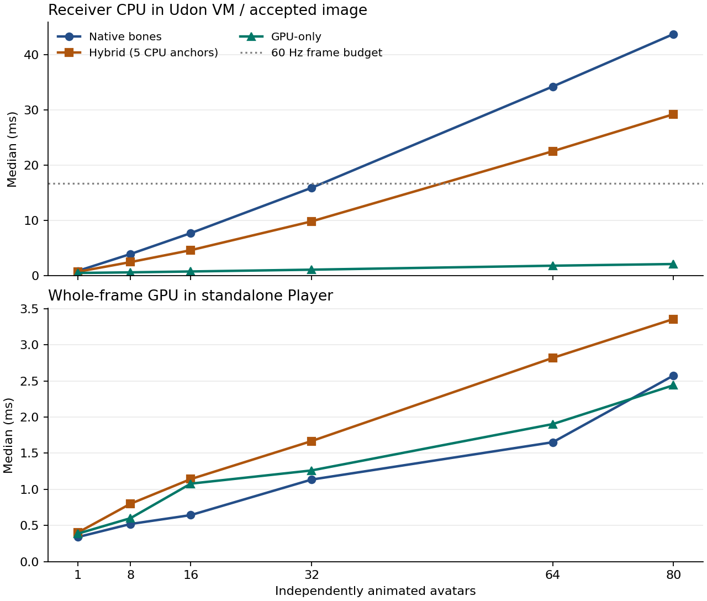

# Scaling independent humanoid receivers

This fixture sends **one frame per update, not one decoder per avatar**. Each Shapell animator has its own network ID, upper-arm angle and 51-bone v4 pose. GPU bodies share immutable geometry and bind-pose data, but never a pose or skin-matrix palette. The wire format is the one used by `TSMPNetworkHumanoidPoseSync`, not the separate VRChat player-pool packet.

## Results

**80 performers:** Native Udon receive work was 43.69 ms median (44.60 ms p95), hybrid 29.19 ms (29.77), GPU-only 2.11 ms (2.23). At this count the nested native pose events alone took 30.65 ms, or 15.25 ms for hybrid. GPU-only issued none; it still did the common decode and maintained an index for the shader channel. With the same 27,528-byte payload, CPU cost was about **20.7x lower** for GPU-only than native. This ratio is not an FPS multiplier.

Whole-frame GPU medians at 80 were 2.57 ms native, 2.44 ms GPU-only, 3.36 ms hybrid. Their p95s were 3.89, 6.75 and 7.88 ms respectively. The two GPU-only trial medians were 2.67 and 2.24 ms: the small difference between the native and GPU-only medians is not evidence that GPU-only renders faster. The native baseline already skins vertices on the GPU. Hybrid renders both a native mesh and a shader-driven mesh.

For a 60 Hz receiver, **32 native rigs already spent 16.15 ms at p95 on receipt alone**, compared with a 16.67 ms frame budget. 32 hybrid rigs used 10.16 ms at p95, leaving almost no CPU room at 90 Hz even before the world runs. Use GPU-only for visual-only actors and reserve native anchors for locally interactive ones. Actual VRChat client cost, sender capture/encode, video transport, crowd occlusion, continuous interpolation, VR stereo, shadows and low-end hardware were not benchmarked. 80 is a verified fixture size, not a supported real-world framerate guarantee.

All 18 population/path combinations passed the per-ID pose checks. Each of the 36 standalone measurement windows observed 160/160 frame-ID changes, with 320 valid GPU timing samples per combination. This is local image playback in a Mono Player, not a frame-loss test in VRChat. See the [timing table and per-trial medians](Evidence/crowd.csv).

## Conditions

- Unity 2022.3.22f1, Core at `f4812e4`, Luma4 1.0.0. Windows, Core i9-13900K, RTX 4090, D3D11. Native rendering: Mono Development Player, 800x600, one orthographic camera, no shadows or stereo. Bodies are laid out in a grid that fits the image: total screen coverage is approximately fixed; triangle count grows with population.
- Full native: discrete pose, fixed-rig cache on, 51 bones updated via Udon, Unity GPU skinning. GPU-only: publish the field to the shader channel, no CPU pose binding. Hybrid: same channel plus five CPU anchors for the native lower-arm mesh; no physics solver. Same mesh, inputs and animation on all three paths.
- Wire: Luma4 1280x720, 4-pixel blocks, sample size 1, eight changing images in a loop; all avatars appear in **every** frame. Network payload = `8 + 344 * N` bytes. The Luma4 payload region holds `320 * (180 - 5 - 1) / 2 = 27,840` bytes. 80 actors use 27,528 bytes; 81 need 27,872. This is a format/configuration limit for this test, not a universal TSMP limit. The decoder byte target is 256x16 through 32 actors, 256x32 above that.
- **CPU metric:** actual Udon VM in ClientSim (Worlds 3.10.4-beta.2), two 80-sample blocks in reverse order after 16 warm-ups each. Sum of decoder submission and completion event work for the same accepted image; excludes waiting, rendering and unrelated world scripts. Nested pose events are included once. One outstanding request makes this an attribution test, not proof of sustained real-client throughput.
- **GPU metric:** whole-frame GPU clock in a separate standalone Player with real rendering and the production decoder, not a shader-only time. Two processes per case, opposite run orders, 64 warm-ups and 160 measured frames per process. RenderDoc attached for present timing; no capture triggered. The Player targets 60 Hz. Do not add CPU and GPU columns together or treat a frame cap as measured headroom.
- The Player checks each CPU receiver's actual arm transform or each GPU palette's decoded arm quaternion (both in hybrid) against a **different expected angle per ID**, checks valid data and a nonblank rendered surface after timing. The VM checks the received ID, number of applied fields and CPU targets' arm rotations. Raw submission logs and per-frame timings are separate from the committed summary.

## Repeat the measurement

1. Prepare the disposable projects and the CPU/GPU/hybrid template scenes as in [the one-rig profile](PROFILE.md). Use real graphics. Add `CrowdProfile.cs` to the no-SDK project's `Assets` and `CrowdProfileBuild.cs` to `Assets/Editor`. Set `TSMP_SKIN_OUT` to an empty absolute directory.
2. Run Unity with `-batchmode -quit -force-d3d11 -projectPath <no-sdk> -executeMethod CrowdProfileBuild.Build`. Repeat with `TSMP_CROWD_WIDE=1` for 64/80. Outputs are `Player/Crowd.exe` and `WidePlayer/Crowd.exe`. Both use the same rendering and receiver scripts.
3. Copy the generated `Assets/SkinCrowd/<count>-<0..7>.asset` inputs to `Assets/SkinProfileInputs` in the SDK project. Install the updated `SkinVmProfile.cs` in `Assets/Editor`. For each count, set `TSMP_CROWD_N=<count>`, then run Unity with `-batchmode -force-d3d11 -projectPath <sdk> -executeMethod SkinVmProfile.Run` **without** `-quit`. Each process writes `vm-<count>.csv`.
4. Set `TSMP_SKIN_CASE=<cpu|gpu|hybrid>-<count>` and `TSMP_SKIN_RUN=A`. Run `renderdoccmd capture -w <path-to-Crowd.exe> -force-d3d11 -screen-width 800 -screen-height 600 -screen-fullscreen 0` per case, then repeat in reverse order as run B. Do not run a VM benchmark or another Player concurrently.
5. Run `python SummarizeCrowd.py <output-directory> Evidence/crowd.csv`. Add `--plot Evidence/crowd.png` with Matplotlib installed to regenerate the figure. The summary includes per-run GPU medians, p95s, native Player main-thread time, nested Udon pose time and observed ID changes.
